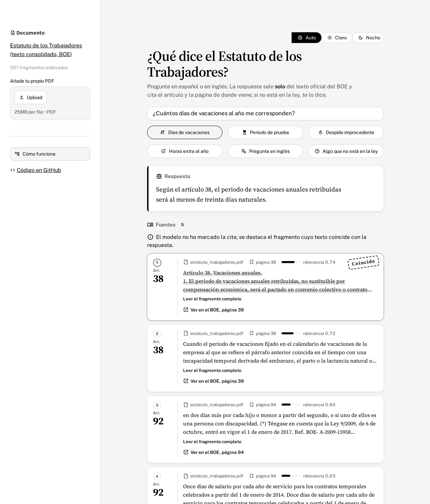
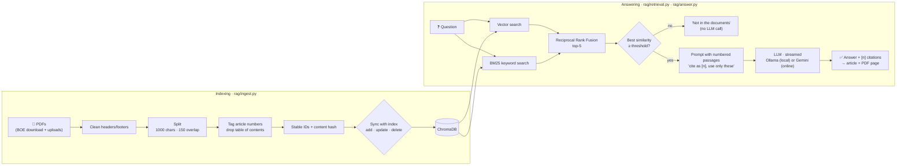

<div align="center">

# 📄 RAG over PDFs — Ask the Spanish Workers' Statute, get cited answers

**A Retrieval-Augmented Generation system that answers questions about a 100+ page legal PDF, citing the exact article and page for every fact, and saying "it's not in the documents" instead of making things up.**

**[▶ Open the live demo](https://estatuto-rag.streamlit.app)** · [Run it in Codespaces](https://codespaces.new/mmartinezvaras/Python-RAG-AI-para-los-PDFs?quickstart=1) · [Evaluation results](eval/results.md)

[](https://github.com/mmartinezvaras/Python-RAG-AI-para-los-PDFs/actions/workflows/tests.yml)


</div>

---

> 🇪🇸 **¿Vienes desde mi CV?** Abre la **[demo online](https://estatuto-rag.streamlit.app)**: no hace falta instalar nada ni crear ninguna cuenta. Pregúntale lo que quieras sobre el Estatuto de los Trabajadores (vacaciones, despidos, jornada, permisos…) y verás la respuesta con el artículo y la página exacta del BOE de donde sale.

<picture>
  <source media="(prefers-color-scheme: dark)" srcset="docs/demo-dark.png">
  
</picture>

## What it does

Ask *"¿Cuántos días de vacaciones me corresponden?"* and you get an answer like:

> Corresponden **30 días naturales** de vacaciones anuales retribuidas **[1]**.
>
> ✅ [1] estatuto_trabajadores.pdf · p. *n* · Art. 38 · relevance score → *link that opens the official BOE PDF at that page*

Ask *"¿Quién ganó el Tour de Francia en 2018?"* and it answers that the documents don't cover it, **without calling the LLM at all**.

## Architecture



## Engineering highlights

- **Hybrid retrieval.** Embeddings understand meaning ("días libres" ≈ "vacaciones") but miss exact tokens like article numbers and figures; BM25 is the opposite. Both rankings are merged with **Reciprocal Rank Fusion**, which needs no score calibration. BM25 is implemented from scratch (~40 lines, tested).
- **Citations you can check.** Passages are numbered in the prompt and the model must cite them as `[n]`. Each chunk knows its **article** (parsed from the "Artículo N." headings, inherited across page breaks) and **page**, and the UI links straight to that page of the official BOE PDF.
- **Refuses instead of hallucinating.** If the best passage's cosine similarity is below a threshold, the system answers "not in the documents" **before** calling the LLM: no tokens spent, no chance to invent. The threshold is calibrated with the evaluation (it prints the similarity distribution for answerable vs. unanswerable questions).
- **An index that stays in sync.** Chunk IDs (`file:page:chunk`) plus a content hash let the indexer add new chunks, **re-embed only chunks whose text changed** (a new version of the law), and **remove chunks of deleted PDFs**, never embedding anything twice. The sync logic is a pure function with its own tests.
- **Measured, not guessed.** `eval/` holds 35 questions with known answers (30 answerable, 5 that aren't in the document). The script reports retrieval hit@5, MRR, answer accuracy (keyword check, then LLM-as-a-judge) and correct refusals, comparing **hybrid vs. vector-only** retrieval. CI runs it on every change; see [eval/results.md](eval/results.md).
- **Runs locally or online with the same code.** Two small provider interfaces (embeddings, LLM). Locally: Ollama, no keys, documents never leave the machine. Online: any OpenAI-compatible API (Gemini's free tier for the public demo), via a dependency-free HTTP client with streaming and retries on rate limits.
- **Cross-lingual questions.** The statute is in Spanish; a question in English is translated into Spanish *for the search only* (small embedding models and BM25 match far better within one language), and the answer is still written in English. Found by the end-to-end tests: English questions retrieved the wrong articles before this.
- **Streaming UX.** The answer appears word by word; sources are known before the first token.
- **Interface designed, not defaulted.** A monochrome "Apple Style" palette (black, graphite, silver, off-white, white; black ink is the accent in light mode, white in night mode), serif for the text of the law, and light, night and automatic themes, with every text colour checked for contrast. Motion follows [Emil Kowalski's design-engineering rules](https://github.com/emilkowalski/skills): one orchestrated moment (sources enter 50 ms apart, then the cited one gets a "Citado" stamp), strong ease-out curves under 400 ms, press feedback on buttons, nothing re-animates when you only switch the theme, and reduced-motion users get fades instead of movement. All PDF and model text is escaped before it reaches the page (tested).
- **Tested and reproducible.** 44 fast unit tests (no models needed; the OpenAI-compatible client is tested against a local fake server), end-to-end tests with the real model, linting, and CI that boots the real Codespaces container and the Docker image and asks them a question.

## Results

Evaluation in CI with Llama 3.2 3B and `nomic-embed-text` on a CPU runner (full report with every miss in [eval/results.md](eval/results.md)):

| | Hybrid (vector + BM25) | Vector only |
|---|---|---|
| Right article retrieved (hit@5) | **87%** | 80% |
| Correct answers | **77%** | 70% |
| Off-topic questions correctly refused | 100% | 100% |

With 30 answerable questions each one is about 3 points, and the 3B model varies by a question or two between runs, so read the gap, not the decimals.

What the evaluation caught along the way: English questions retrieved the wrong articles (fixed by translating the query), and showing the model that translation then made it answer in Spanish (fixed by ending the prompt with the answer language). What the remaining misses teach: questions whose wording doesn't share vocabulary with the law ("¿a partir de qué edad se puede trabajar?" vs. "menores de dieciséis años") are still hard to retrieve, and the 3B model sometimes picks the wrong passage when two articles are similar (objective vs. unfair dismissal). A reranker and a larger model are the obvious next experiments, and the evaluation is there to measure them.

## Key design choices

| Decision | Choice | Why |
|---|---|---|
| Dataset | Estatuto de los Trabajadores (BOE consolidated text) | Long, real, in Spanish, dense with exact numbers; every answer is checkable against an official source |
| Chunking | 1000 chars, 150 overlap, split preferably at "Artículo" | Legal articles are short; bigger chunks keep a rule and its exceptions together |
| Retrieval | Hybrid (vector + BM25, RRF), top-5 | Exact figures and article numbers matter in legal text; see the evaluation for the comparison |
| Refusal | Cosine threshold before the LLM | Cheap, deterministic guard; the prompt also tells the model to refuse |
| Vector store | ChromaDB (local, persistent) | Zero infrastructure |
| Local models | Llama 3.2 3B + `nomic-embed-text` (with its task prefixes) on Ollama | Runs offline on a laptop CPU |
| Online models | Gemini via its OpenAI-compatible API | Free tier, no GPU needed to host the demo |

## Run it

**Online:** [live demo](https://estatuto-rag.streamlit.app), nothing to install.

**GitHub Codespaces (one click):** [open a codespace](https://codespaces.new/mmartinezvaras/Python-RAG-AI-para-los-PDFs?quickstart=1), wait ~5 minutes the first time (it installs Ollama, downloads the models and the PDF, and builds the index), and the demo opens by itself. If it doesn't, open the **Ports** tab and click 🌐 next to port 8501.

**Your computer (macOS / Windows):** install [Ollama](https://ollama.com/download), then:

```bash
git clone https://github.com/mmartinezvaras/Python-RAG-AI-para-los-PDFs.git
cd Python-RAG-AI-para-los-PDFs
python -m venv .venv && source .venv/bin/activate   # Windows: .venv\Scripts\activate
pip install -r requirements.txt

ollama pull nomic-embed-text && ollama pull llama3.2:3b
python populate_database.py        # downloads the PDF from the BOE and builds the index

streamlit run app.py               # web demo at http://localhost:8501
python query_data.py "¿Cuánto dura el periodo de prueba de un técnico titulado?"
```

**Linux:** `bash scripts/setup.sh` does all of the above (including installing Ollama), then `bash scripts/run_app.sh`.

**Docker:** `docker build -t rag-demo . && docker run -p 7860:7860 rag-demo`, then open http://localhost:7860.

**Your own PDFs:** drop them in `data/` (or upload them in the sidebar) and run `python populate_database.py`. Only new or changed chunks are embedded.

### Configuration

| Variable | Default | Purpose |
|---|---|---|
| `RAG_LLM_PROVIDER` | `ollama` | `ollama` or `openai` (any OpenAI-compatible API: Gemini, Groq, OpenAI…) |
| `RAG_EMBEDDINGS` | `ollama` | `ollama`, `openai` or `bedrock` |
| `RAG_LLM_MODEL` / `RAG_EMBED_MODEL` | `llama3.2:3b` / `nomic-embed-text` | Model names for the chosen providers |
| `OPENAI_BASE_URL` / `OPENAI_API_KEY` | Gemini's endpoint / – | For the `openai` providers |
| `RAG_RETRIEVAL` | `hybrid` | `hybrid` or `vector` |
| `RAG_MIN_RELEVANCE` | `0.64` | Refusal threshold (cosine similarity); calibrate it per embedding model |
| `RAG_DOC_LANGUAGE` | `es` | Language of the documents; questions in another language are translated before searching (`""` disables) |
| `RAG_JUDGE_MODEL` | the LLM | A stronger model to grade the evaluation |

Rebuild with `python populate_database.py --reset` after changing the embedding model.

### Deploy your own online demo (free)

1. Get a free API key at [Google AI Studio](https://aistudio.google.com/apikey).
2. On [Streamlit Community Cloud](https://share.streamlit.io), create an app from this repository with `app.py` as the entry point.
3. In **Advanced settings → Secrets**, paste the contents of [`.streamlit/secrets.toml.example`](.streamlit/secrets.toml.example) with your key.

On first start the app downloads the PDF and builds the index through the API (a couple of minutes).

## Evaluation and tests

```bash
pytest -m "not llm"                         # 44 fast tests, no models needed
pytest -m llm -v                            # end-to-end with the real model
python -m eval.run_eval                     # full evaluation → eval/results.md
python -m eval.run_eval --retrieval-only    # retrieval metrics in seconds, to tune chunking or the threshold
```

## Project structure

```text
├── app.py                 # Streamlit demo: streaming answer, citations, PDF page links, uploads
├── ui/                    # theme (light / night / auto) and the HTML of the answer and source cards
├── rag/
│   ├── config.py          # every setting, overridable by environment variables
│   ├── providers.py       # Ollama / OpenAI-compatible (Gemini) / Bedrock behind two small interfaces
│   ├── documents.py       # dataset definition and download from the BOE
│   ├── ingest.py          # clean → split → tag articles → IDs + hashes → sync with ChromaDB
│   ├── retrieval.py       # BM25, vector search, reciprocal rank fusion
│   └── answer.py          # relevance gate, cited prompt, streamed answer
├── eval/                  # 35-question evaluation set and runner (hybrid vs. vector)
├── tests/                 # unit tests (+ small fixture PDFs) and end-to-end tests
├── populate_database.py   # CLI: build / sync the index
├── query_data.py          # CLI: ask a question
├── scripts/, docker/      # setup and launch scripts (Codespaces, CI, Docker)
├── .devcontainer/         # GitHub Codespaces one-click environment
└── .github/workflows/     # CI: lint, unit tests, Codespaces + Docker smoke tests, evaluation
```

## Next steps

- A cross-encoder reranker after the fusion step, measured with the same evaluation
- Conversational follow-up questions ("¿y si llevo menos de un año?")
- Highlight the cited sentence inside the PDF page

---

<div align="center">

Built by **Marcos** · [@mmartinezvaras](https://github.com/mmartinezvaras)

</div>
