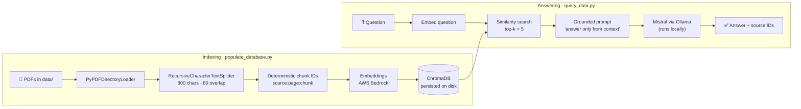

<div align="center">

# 📄 RAG over PDFs — Ask your documents, get cited answers

**A Retrieval-Augmented Generation pipeline that indexes PDF documents into a vector database and answers questions with a local LLM, grounded only in your documents and with a source for every answer.**


</div>

---

## The problem

LLMs answer confidently even when they don't know, and they know nothing about **your** documents. RAG fixes both: before the model answers, the system retrieves the most relevant passages from your own PDFs and instructs the model to answer **only from that context**, returning the exact chunks it used.

```text
# Illustrative run against the sample PDFs
$ python query_data.py "When was the first Formula One season?"

Response: The first Formula One season was held in 1950.
Sources: ['data/formula_one.pdf:0:0', 'data/formula_one.pdf:0:1', ...]
```

## Architecture



## Engineering highlights

- **Incremental indexing, no duplicates.** Every chunk gets a deterministic ID (`data/file.pdf:page:chunk_index`). On each run the script reads the IDs already stored in Chroma and **embeds only new chunks**, so adding one PDF to a large library doesn't re-embed (and re-pay for) everything.
- **Traceable answers.** The chunk IDs travel with the retrieved context, so every answer points to the exact file, page and chunk it came from.
- **Hybrid cloud / local design.** Embeddings come from AWS Bedrock, generation runs on a local Mistral model through Ollama. Both sit behind one factory function (`get_embedding_function()`), so switching to fully-local embeddings (`nomic-embed-text` on Ollama) is a one-line change.
- **Hallucination guard in the prompt.** The template restricts the model to the retrieved context instead of its general knowledge.
- **LLM-as-a-judge evaluation.** `test_rag.py` asks questions with known answers, then a second LLM call judges whether the generated answer matches the expected one, turning a fuzzy text comparison into a `pytest` pass/fail.
- **Reset switch.** `python populate_database.py --reset` rebuilds the vector store from scratch.

## Key design choices

| Decision | Choice | Why |
|---|---|---|
| Chunk size | 800 characters, 80 overlap | Small enough to retrieve precise passages; the 10 % overlap keeps sentences that cross a boundary |
| Retrieval depth | top-k = 5 | Enough context for multi-part answers without flooding the prompt |
| Vector store | ChromaDB (local, persistent) | Zero infrastructure; survives restarts |
| LLM | Mistral 7B on Ollama | Runs offline on a laptop; documents never leave the machine at generation time |

## Quick start

```bash
# 1. Dependencies
python -m venv .venv && source .venv/bin/activate
pip install -r requirements.txt langchain-community langchain-text-splitters

# 2. Local LLM
ollama pull mistral

# 3. Embeddings: configure an AWS profile with Bedrock access (region us-east-1)
aws configure

# 4. Index the PDFs in data/
python populate_database.py          # add --reset to rebuild from scratch

# 5. Ask
python query_data.py "What are the basic rules of football?"

# 6. Evaluate
pytest test_rag.py
```

Want everything local? In `get_embedding_function.py`, swap `BedrockEmbeddings` for the commented `OllamaEmbeddings(model="nomic-embed-text")` and run `ollama pull nomic-embed-text`.

## Project structure

```text
├── data/                      # Source PDFs (sample: football.pdf, formula_one.pdf)
├── chroma/                    # Persisted vector database
├── get_embedding_function.py  # Embedding provider factory (Bedrock / Ollama)
├── populate_database.py       # Load → split → ID → embed → store (incremental)
├── query_data.py              # Retrieve → prompt → generate → cite
├── test_rag.py                # LLM-as-a-judge evaluation with pytest
└── requirements.txt
```

## Tech stack

| Area | Tools |
|---|---|
| Orchestration | LangChain |
| Document loading | pypdf |
| Vector store | ChromaDB |
| Embeddings | AWS Bedrock (boto3) · Ollama `nomic-embed-text` (optional) |
| LLM | Mistral via Ollama |
| Testing | pytest |

## Next steps

- Return relevance scores with each source and drop low-similarity chunks
- A small web UI (Streamlit or FastAPI) on top of `query_rag()`
- A larger evaluation set to measure answer accuracy across documents

---

<div align="center">

Built by **Marcos** · [@mmartinezvaras](https://github.com/mmartinezvaras)

</div>
