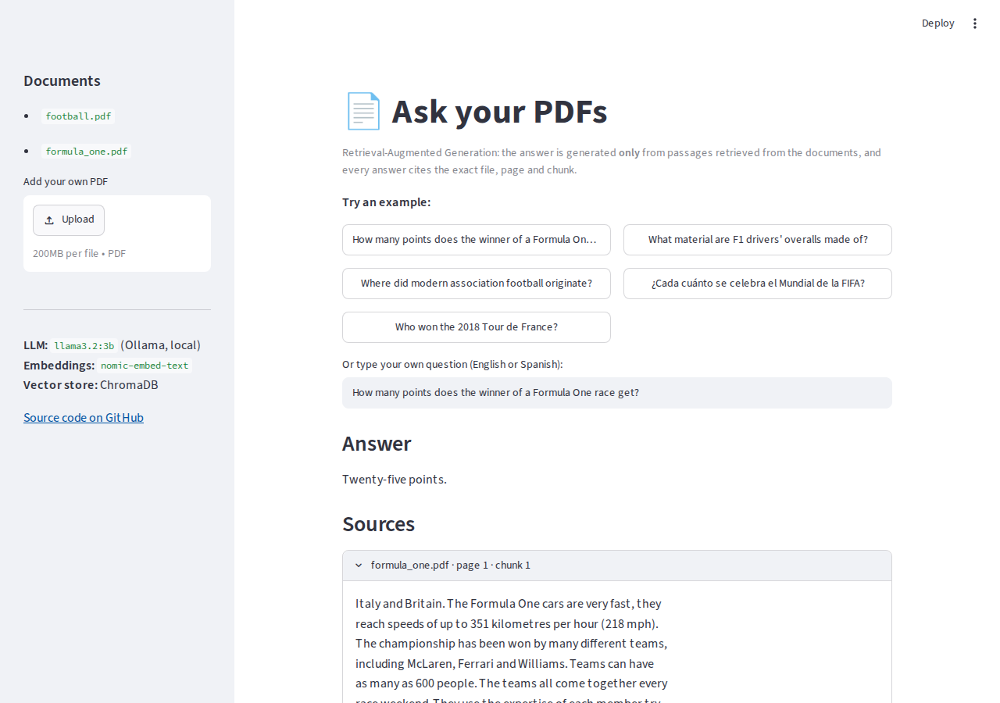
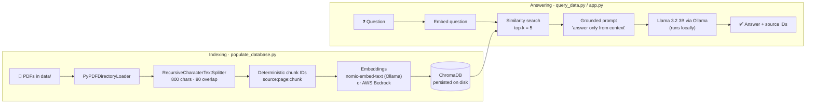

<div align="center">

# 📄 RAG over PDFs — Ask your documents, get cited answers

**A Retrieval-Augmented Generation pipeline that indexes PDF documents into a vector database and answers questions with a local LLM, grounded only in your documents and with a source for every answer.**

[](https://codespaces.new/mmartinezvaras/Python-RAG-AI-para-los-PDFs?quickstart=1)

[](https://github.com/mmartinezvaras/Python-RAG-AI-para-los-PDFs/actions/workflows/tests.yml)


</div>

---

## ▶️ Try it in one click, nothing to install

> 🇪🇸 **¿Vienes desde mi CV?** Pulsa el botón de abajo y en unos minutos tendrás la demo funcionando en tu navegador, sin instalar nada.

1. Click **[Open in GitHub Codespaces](https://codespaces.new/mmartinezvaras/Python-RAG-AI-para-los-PDFs?quickstart=1)** and then **Create codespace** (you need a free GitHub account; it runs on GitHub's free monthly quota).
2. Wait about **5 minutes** the first time: it installs everything, downloads the local AI model and indexes the PDFs. You can follow the progress in the terminal.
3. The web demo opens by itself. Click one of the example questions, or ask your own in English or Spanish. You can also upload your own PDF from the sidebar.

If the demo tab doesn't open, go to the **Ports** tab at the bottom and click the 🌐 icon next to port **8501**.



> Every change to this repository runs the full pipeline in GitHub Actions: it installs Ollama, indexes the PDFs, answers questions with the real model and checks them with an LLM judge (see the **tests** badge above).

## The problem

LLMs answer confidently even when they don't know, and they know nothing about **your** documents. RAG fixes both: before the model answers, the system retrieves the most relevant passages from your own PDFs and instructs the model to answer **only from that context**, returning the exact chunks it used.

```text
$ python query_data.py "When was the first Formula One season?"

Response: The first Formula One season was in 1950.
Sources: ['data/formula_one.pdf:0:0', 'data/formula_one.pdf:0:2', 'data/formula_one.pdf:0:1', ...]
```

## Architecture



## Engineering highlights

- **Incremental indexing, no duplicates.** Every chunk gets a deterministic ID (`data/file.pdf:page:chunk_index`). On each run the script reads the IDs already stored in Chroma and **embeds only new chunks**, so adding one PDF to a large library doesn't re-embed (and re-pay for) everything. A unit test proves it.
- **Traceable answers.** The chunk IDs travel with the retrieved context, so every answer points to the exact file, page and chunk it came from.
- **Fully local by default, cloud optional.** Embeddings and generation run on Ollama, so documents never leave the machine and no API keys are needed. Both providers sit behind one factory (`get_embedding_function()`); `RAG_EMBEDDINGS=bedrock` switches embeddings to AWS Bedrock.
- **Hallucination guard in the prompt.** The template restricts the model to the retrieved context and tells it to say "I don't know" otherwise (try the Tour de France example in the demo).
- **LLM-as-a-judge evaluation.** `test_rag.py` asks questions with known answers from the PDFs, then a second LLM call judges whether the generated answer matches, turning a fuzzy text comparison into a `pytest` pass/fail.
- **Reproducible in CI and in one click.** The same `scripts/setup.sh` powers GitHub Codespaces and the GitHub Actions end-to-end job, so the demo setup is tested on every change.

## Key design choices

| Decision | Choice | Why |
|---|---|---|
| Chunk size | 800 characters, 80 overlap | Small enough to retrieve precise passages; the 10 % overlap keeps sentences that cross a boundary |
| Retrieval depth | top-k = 5 | Enough context for multi-part answers without flooding the prompt |
| Vector store | ChromaDB (local, persistent) | Zero infrastructure; survives restarts |
| LLM | Llama 3.2 3B on Ollama | Runs offline on a laptop CPU with good quality; documents never leave the machine. Any Ollama model works via `RAG_LLM_MODEL` (e.g. `mistral`) |
| Embeddings | `nomic-embed-text` on Ollama | Free and local; AWS Bedrock available as an option |

## Run it on your own computer

**macOS / Windows:** install [Ollama](https://ollama.com/download) and open it. Then:

```bash
git clone https://github.com/mmartinezvaras/Python-RAG-AI-para-los-PDFs.git
cd Python-RAG-AI-para-los-PDFs

python -m venv .venv
source .venv/bin/activate          # Windows: .venv\Scripts\activate
pip install -r requirements.txt

ollama pull nomic-embed-text
ollama pull llama3.2:3b
python populate_database.py        # add --reset to rebuild from scratch

streamlit run app.py               # web demo at http://localhost:8501
python query_data.py "How often is the FIFA World Cup held?"   # or use the command line
```

**Linux:** `bash scripts/setup.sh` does all of the above (including installing Ollama), then `bash scripts/run_app.sh`.

**With Docker (any OS, nothing else to install):** the image bundles Ollama, the models and the indexed PDFs.

```bash
docker build -t rag-demo .
docker run -p 7860:7860 rag-demo     # open http://localhost:7860
```

### Configuration

| Variable | Default | Purpose |
|---|---|---|
| `RAG_LLM_MODEL` | `llama3.2:3b` | Ollama model that writes the answers |
| `RAG_EMBED_MODEL` | `nomic-embed-text` | Ollama embedding model |
| `RAG_EMBEDDINGS` | `ollama` | Set to `bedrock` to use AWS Bedrock (`pip install langchain-aws` and an AWS profile with Bedrock access) |

Rebuild the index with `python populate_database.py --reset` after changing the embedding model.

## Tests

```bash
pytest -m "not llm"   # fast pipeline tests: loading, chunking, IDs, incremental indexing (no LLM needed)
pytest -m llm -v      # end-to-end evaluation with the real model (needs Ollama running)
```

## Project structure

```text
├── app.py                     # Streamlit web demo (answers + cited sources + PDF upload)
├── data/                      # Source PDFs (sample: football.pdf, formula_one.pdf)
├── get_embedding_function.py  # Embedding provider factory (Ollama / Bedrock)
├── populate_database.py       # Load → split → ID → embed → store (incremental)
├── query_data.py              # Retrieve → prompt → generate → cite
├── test_pipeline.py           # Fast unit tests for the indexing pipeline
├── test_rag.py                # LLM-as-a-judge evaluation with pytest
├── scripts/                   # One-shot setup and launch scripts
├── Dockerfile, docker/        # Whole demo in one container
├── .devcontainer/             # GitHub Codespaces one-click environment
├── .github/workflows/         # CI: unit tests + end-to-end run with Ollama
└── requirements.txt
```

## Tech stack

| Area | Tools |
|---|---|
| Orchestration | LangChain |
| Document loading | pypdf |
| Vector store | ChromaDB |
| Embeddings | Ollama `nomic-embed-text` · AWS Bedrock (optional) |
| LLM | Llama 3.2 3B via Ollama (any Ollama model) |
| Web demo | Streamlit |
| Testing & CI | pytest · GitHub Actions · GitHub Codespaces |

## Next steps

- Return relevance scores with each source and drop low-similarity chunks
- A larger evaluation set to measure answer accuracy across documents
- Hybrid search (keyword + vector) for exact names and numbers

---

<div align="center">

Built by **Marcos** · [@mmartinezvaras](https://github.com/mmartinezvaras)

</div>
